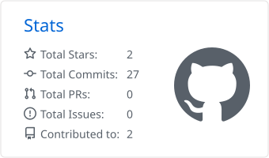
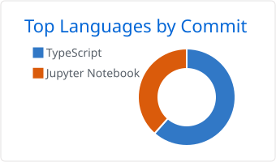

<div align="center">


# gabriela g 🎲 


</div>

<br/>

## ficha

```js
const me = {
  local:       "Campinas, SP 🇧🇷",
  area:        "Análise de dados • B.I | M.I.S",
  diaADia:     ["SQL", "DuckDB", "MySQL/MariaDB", "KNIME", "Power BI"],
  aprendendo:  ["JavaScript", "TypeScript", "React", "Node/Express", "Vitest"]
};
```

- 📊 dashboards executivos e indicadores de negócio (KPIs, comparativos MoM / YoY / YTD)
- 🗄️ modelagem de rollups, queries otimizadas e validação de métricas
- ⚛️ levando os dados para a web com React + TypeScript + Express
- 🧪 testes unitários para garantir que nenhuma métrica diverge
- 💬 vamos conversar sobre: SQL, visualização de dados, automação e dashboards

<br/>

## stack

**⚔️ dados & analytics**


**🛠️ desenvolvimento** (em evolução 🚧)


<br/>

## github em números

<div align="center">

<picture>
  <source media="(prefers-color-scheme: dark)" srcset="https://raw.githubusercontent.com/gabrriela07/gabrriela07/main/profile-summary-card-output/github_dark/3-stats.svg" />
  <source media="(prefers-color-scheme: light)" srcset="https://raw.githubusercontent.com/gabrriela07/gabrriela07/main/profile-summary-card-output/github/3-stats.svg" />
  
</picture>
<picture>
  <source media="(prefers-color-scheme: dark)" srcset="https://raw.githubusercontent.com/gabrriela07/gabrriela07/main/profile-summary-card-output/github_dark/2-most-commit-language.svg" />
  <source media="(prefers-color-scheme: light)" srcset="https://raw.githubusercontent.com/gabrriela07/gabrriela07/main/profile-summary-card-output/github/2-most-commit-language.svg" />
  
</picture>

<picture>
  <source media="(prefers-color-scheme: dark)" srcset="https://streak-stats.demolab.com?user=gabrriela07&hide_border=true&background=0d1117&ring=a78bfa&fire=22d3ee&currStreakLabel=c4b5fd&sideLabels=c9d1d9&currStreakNum=c9d1d9&sideNums=c9d1d9&dates=8b949e&border_radius=12" />
  <source media="(prefers-color-scheme: light)" srcset="https://streak-stats.demolab.com?user=gabrriela07&hide_border=true&background=ffffff&ring=7c3aed&fire=0891b2&currStreakLabel=7c3aed&sideLabels=24292f&currStreakNum=24292f&sideNums=24292f&dates=6e7781&border_radius=12" />
  
</picture>

<picture>
  <source media="(prefers-color-scheme: dark)" srcset="https://github-readme-activity-graph.vercel.app/graph?username=gabrriela07&bg_color=0d1117&color=c9d1d9&line=a78bfa&point=22d3ee&area=true&area_color=a78bfa&hide_border=true&radius=12" />
  <source media="(prefers-color-scheme: light)" srcset="https://github-readme-activity-graph.vercel.app/graph?username=gabrriela07&bg_color=ffffff&color=24292f&line=7c3aed&point=0891b2&area=true&area_color=a78bfa&hide_border=true&radius=12" />
  
</picture>

</div>

<br/>

## 🐍 comendo o calendário de contribuições

<div align="center">

<picture>
  <source media="(prefers-color-scheme: dark)" srcset="https://raw.githubusercontent.com/gabrriela07/gabrriela07/output/github-snake-dark.svg" />
  <source media="(prefers-color-scheme: light)" srcset="https://raw.githubusercontent.com/gabrriela07/gabrriela07/output/github-snake.svg" />
  
</picture>

</div>

<br/>

## 🗺️ roadmap de aprendizado

| Etapa | Tema | Status |
|:-:|:--|:-:|
| 1 | SQL avançado, rollups e performance de queries | ✅ |
| 2 | Visualização de dados e storytelling | ✅ |
| 3 | JavaScript / TypeScript | 🔄 |
| 4 | React + ECharts para dashboards web | 🔄 |
| 5 | APIs com Node/Express | 🔄 |
| 6 | Testes automatizados (Vitest) | 🔄 |
| 7 | Deploy & CI/CD com GitHub Actions | ⏳ |

<br/>

## contato

<div align="center">

[](https://www.linkedin.com/in/gabriela-garcia94)
[](mailto:gabriela.grc@outlook.com)

</div>
